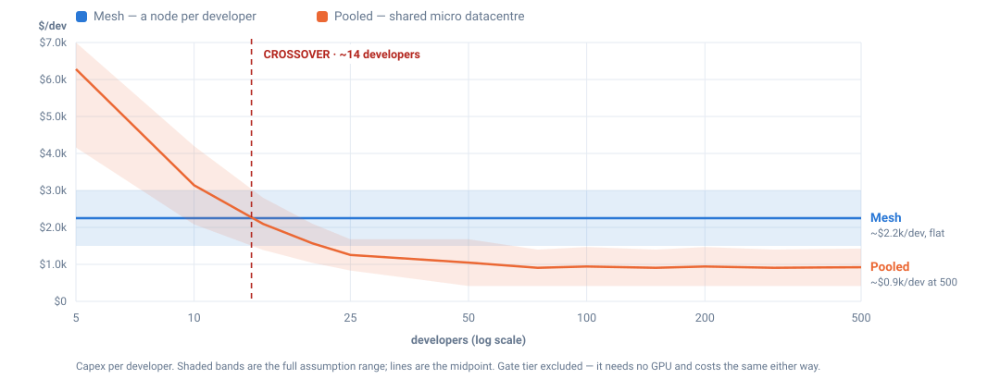

# Roadmap — planned, not built

Design notes for two capabilities we intend to build. **Nothing here is
implemented.** No code in this repository depends on anything on this page.
Recorded now so the architecture we ship today does not foreclose it.

Both items were chosen because they compound: loops are only affordable
because of the subagent tier, and loops are only *useful* with shared memory.
Neither is worth building alone.

---

## 1. Loops — iterate instead of answering once

**Today.** One shot. Prompt in, answer out. If the answer is wrong, the human
notices and re-prompts. The agent never sees the consequence of its own work.

**Goal.** A bounded plan → act → observe → repeat cycle: write the fix, run the
tests, read the failure, correct it, stop when green or when the budget is
spent.

### Why this is affordable here specifically

A naive loop on a 24B model at 4.94 tok/s is unusable — ten iterations of a
300-token answer is ten minutes of silence. The org chart is what makes it
viable: **the loop controller is not the engineer.**

| Loop responsibility | Who does it | Cost |
|---|---|---|
| Decide whether to continue | clerk (0.6B) | ~200 ms |
| Summarise a test failure | clerk (0.6B) | ~300 ms |
| Re-check the gate each turn | sentry (45 MB) | ~50 ms |
| Actually write code | engineer (24B) | ~60 s |

The expensive tier is woken only for the step that genuinely needs generation.
Everything else — control flow, triage, summarisation, gate re-evaluation —
runs on models that answer in milliseconds. A ten-iteration loop that calls the
engineer three times costs three minutes, not ten.

### What it needs

- **Hard budgets**: wall-clock, iteration count, and token ceilings, enforced
  by the router, not requested of the model.
- **An observation channel**: run the test suite, capture stdout/stderr, read
  the files that changed. Each of these is a tool call.
- **Every iteration re-enters the gate.** This is the security consequence and
  the reason this is a design note rather than a weekend project: a loop
  multiplies gate decisions by the iteration count. It is only safe because the
  gate is already cheap (18 ms) and deterministic. A loop must never become a
  path by which content that failed the gate on turn one leaks out on turn six
  in a different wording — so classification runs on *every* turn, over the
  full accumulated context, not just the initial prompt.
- **Anti-thrash state**: what has been tried and what failed, so the loop does
  not oscillate between two wrong answers.
- **A visible stop reason** on the UI: solved / budget exhausted / blocked by a
  gate / human interrupt. A loop that ends silently is worse than no loop.

### Explicit non-goals

Unbounded autonomy. No loop runs without a ceiling, and no loop acquires
permissions its single-shot equivalent would not have had.

---

## 2. Shared on-prem memory of the codebase

**Today.** Each task re-reads files from disk and ranks them lexically (IDF).
Nothing is remembered between tasks. Every task starts from zero.

**Goal.** A persistent, branch-aware, on-prem index of the codebase, shared by
every agent and every node — the `brain/` directory this repository already
scaffolds but does not yet populate.

### Branch awareness is the point

Two indexes, maintained separately:

- **`production`** — what customers are actually running.
- **`development`** — what is in flight.

That distinction is what makes the memory worth having rather than merely
convenient. It lets an agent answer questions no single-shot context window
can: *is this bug present in what shipped, or only on dev?* *Was this
refactor already attempted and reverted?* *What does the diff between these
branches actually change in behaviour?*

### It reuses what is already resident

The embedding model for this is **already loaded**: `all-minilm`, 45 MB,
18 ms per embedding, running on CPU. Indexing a repository is an offline batch
job against a model that is already paid for. No new dependency, no new
hardware, no per-token cost.

Pair it with the two halves the scaffolding already describes:

- `brain/memory/` — machine recall: embeddings, symbol graph, per-branch index.
- `brain/obsidian-vault/` — human-readable decisions and runbooks, git-versioned,
  so the *reasoning* behind a change survives, not only the change.

### The strategic argument — this is the slide that matters

BIG-AI is permitted to see a **285-byte slice**. The on-prem tier is permitted
to see **the entire repository, its history, and the reasoning behind every
decision in it.**

So the local model is not the weaker option that you tolerate for security
reasons. On the axis that actually determines answer quality on a mature
codebase — context — **it is the only option that can ever be well-informed**,
because it is the only one allowed to read everything. That gap widens every
day the system runs. The hosted model gets a keyhole; the local model gets the
building.

### Consequences we must design for

- **The index is protected IP.** An embedding index over proprietary source is
  a lossy but real representation of that source. It must live inside
  `protected_paths` from day one and must never be stageable for egress. This
  is not an afterthought — it is the first line of the design. **Section 6
  refines this**: splitting the store in two makes the protection structural
  rather than a rule someone has to keep keeping.
- **Staleness.** Invalidate on commit via a git hook; re-index incrementally.
  A confidently wrong memory is worse than no memory.
- **Multi-node coherence.** "Shared" means one index, many workers. Whoever
  owns writes owns invalidation.
- **Provenance on every recall.** A retrieved fact carries the file, the
  branch, and the commit it came from, so a human can check it.

---

## Sequencing

Memory first, loops second. A loop without memory repeats its own mistakes
across tasks; memory without loops still improves every single-shot answer.
Neither should start before the boolean/fuzzy rules engine is finished, because
both increase the number of gate evaluations and the gate should be complete
before it is put under that load.

---

## 3. Fleet shape — mesh grid vs. micro datacentre

**Planned, not built. No code here.** The question: for a team of 5 to 500
developers, do you give every developer a node (mesh), or pool
$100k–$300k of GPUs into one on-prem micro datacentre?

The answer is not one or the other, and the reason falls straight out of the
tiering we already measured.

### The physics that decides it: batching

A single inference stream is memory-bandwidth-bound — one token requires
reading every weight. Crucially, **that read is shared across concurrent
requests**. A GPU serving 20 developers at once reads the weights once and
serves all 20 from it. Aggregate throughput therefore scales close to linearly
with concurrency until the card becomes compute-bound.

A mesh node serving exactly one developer can never do this. It pays the full
weight-read for a single stream, every time.

### The economics that follow: utilisation

A developer issues on the order of tens of prompts a day. At ~30 s of compute
each, that is roughly **20–30 minutes of GPU time per 8-hour day — under 6%
utilisation.** In a mesh, you buy 100% of the hardware to use 6% of it. Pooling
converts that idle 94% into either fewer cards or faster answers for everyone.

### Where the crossover sits

Modelled in `bench/fleet.py`, as bands rather than false precision. Inputs:
mesh node $1.5k–$3k (16 GB+ VRAM, per the residency cliff), pooled GPU $8k–$15k,
30–40% cluster overhead, 15–25 developers served per pooled GPU, and a two-GPU
floor for redundancy.

**Crossover: ~14 developers.** Below that you are buying cluster capacity nobody
is using — at 5 desks a two-GPU floor works out to roughly $6.3k per developer
against ~$2.2k for a mesh node. Above it, pooled capex per head falls away and
the gap widens without limit.

| Team | Mesh capex | Pooled capex | GPUs |
|---|---|---|---|
| 5 | $8k–15k | $21k–42k | 2 |
| 25 | $38k–75k | $21k–42k | 2 |
| 100 | $150k–300k | $42k–147k | 4–7 |
| 500 | $750k–1,500k | $208k–714k | 20–34 |

### The honest part about the $100k–$300k envelope

At 500 seats the stated envelope holds **only at the favourable end of the
assumptions**. The unfavourable end is $714k — roughly 2.4× the ceiling.

The entire spread is driven by one parameter: **developers served per pooled
GPU**. It should be the first thing a pilot measures, before anyone signs a
purchase order. We would rather publish the sensitivity than quote the
flattering end of it.

*Capex per developer by team size. Shaded bands are the full assumption range;
lines are the midpoint. Generated by `bench/make_fleet_chart.py` from
`bench/fleet.json` — regenerate rather than edit.*

### Two procurement paths

Both are on the table, and they are genuinely different businesses:

- **Client-supplied hardware.** The customer buys their own GPUs; we supply the
  router, rules engine, models and subscriptions. Software margins, no working
  capital, no inventory, and it shortens the cycle with security teams who
  insist on owning the metal.
- **We supply the cluster.** We procure, integrate, certify and ship the micro
  datacentre as one appliance. Much larger deals, and it is what makes the
  hardware-refresh tier and the take-back channel work at all — but it is a
  hardware business, with the working capital and thinner blended margins that
  implies. Price it as such rather than pretending it is software.

### The recommended shape — and it is the org chart again

The tiering we already ship answers this cleanly, because the tiers have
opposite hardware profiles:

- **Mesh the perimeter.** The sentry (45 MB) and clerk (0.6B) run on *every*
  developer machine. They need no GPU at all, they answer in milliseconds, and
  the security decision must be made **before** anything leaves the developer's
  own machine — including before it crosses your own LAN. The gate belongs at
  the edge, on every node, always.
- **Pool the horsepower.** The engineer tier (24B and, later, larger) lives in
  the micro datacentre, batched across the team, upgraded centrally, and
  serving work that has *already* cleared a local gate.

So: **the router is meshed; the compute is centralised.** Nothing reaches the
cluster that a local, deterministic gate has not already cleared.

### The security trade, stated honestly

Pooling is not free from a containment standpoint, and we should say so:

- A mesh keeps each developer's code on their own machine. Smallest blast
  radius per node — but N times the attack surface and N times the patching
  burden.
- A micro datacentre is a **shared multi-tenant system**. Code crosses your own
  LAN to reach it, and a compromise of the cluster exposes many developers'
  work at once rather than one person's. That demands tenant isolation, per-tenant
  audit, and encryption in transit *inside* the perimeter — none of which the
  current single-node design needs.

This is why the gate stays meshed even when the compute centralises. The
cluster is a compute resource, not a trust boundary.

### Ties to the commercial model

The hardware-refresh tier feeds this directly: cards retired from the pooled
cluster are exactly the right specification to seed or refresh mesh nodes, and
the entry-tier appliance for smaller customers. One fleet, three lives.

---

## 4. Multi-site continuity

Full design note: **`security/disaster-recovery.md`**.

Summary: 15-minute RPO, two geographically separated sites (e.g. Baltimore and
Chicago — different power grids, weather systems and FEMA regions), append-only
replicas that a compromised node has no authority to alter.

Two points from that note worth carrying into any customer conversation:

- **Restore order is rules → audit → memory → compute.** A node that comes back
  before its gate does is a node with no perimeter.
- **Replication is egress.** Shipping protected IP between sites every fifteen
  minutes is protected material crossing a network. It is held to the same
  discipline as any other egress: encrypted, private, logged to the same audit
  topics, and restricted to declared destinations.

It is also the recovery half of the ransomware control already specified in
`security/monitors/behavioral_rules.yaml` — detection without recovery is half
a control.

---

## 5. The perimeter widens to the LAN — never to the internet

**Partly built.** The `sovereign` posture ships today and is enforced by
`security/egress_guard.py`. What is roadmap is the *shape* of the ring, not
the existence of it.

### What ships

A fourth posture that does not route around risk but removes the capability.
While it is armed, every non-loopback destination is refused before the
`connect()` syscall — DNS included, because resolving a name is itself a
packet leaving. The three other modes decide *where* work goes; this one
decides *whether a socket opens at all*.

The MVP ring is deliberately the tightest one: **loopback only** —
`127.0.0.0/8`, `::1`, and `AF_UNIX` sockets, none of which can put a frame on
a wire. That is the deny-all-outbound rule applied at the host.

### What is honestly not enforced

It is a **process-level** guard, not a host-level one. It covers every socket
this router opens — `connect`, `connect_ex`, `sendto`, `create_connection`,
`getaddrinfo`, `gethostbyname`, `gethostbyaddr`, which is every path urllib,
http.client and the Ollama adapter take. It does not cover a child process, a
raw `_socket.socket` built to dodge it, or anything else on the machine.

Production containment is a host firewall or a network namespace with no
default route. The guard is what makes the posture **demonstrable and
fail-closed inside the router**: `arm()` refuses unless a boot self-test has
proved that it blocks, so a failed guard makes the posture *unavailable*
rather than *unenforced*. Do not describe it as an air gap, in a deck or
anywhere else.

### The ring that has to come next

The customer picture is not one machine. It is a developer workstation, a
second node on the same LAN, and — per section 3 — a pooled GPU box in a
micro datacentre. All of those are inside the building. **BIG-AI is not.**

So the real boundary is not "this host", it is **the external firewall**: deny
all inbound and outbound at the edge, while the internal mesh talks freely.
The MVP collapses that to loopback because a one-machine perimeter is the only
one we can enforce and prove today; the target widens the ring to declared
on-prem destinations and nothing else.

That is a change to one function — `_permitted()` in
`security/egress_guard.py` — plus the policy surface to declare peers:

- **Declared destinations only.** A CIDR list, not "the LAN". `10.0.0.0/8` is
  not a security boundary; `10.20.4.7:11434, the GPU pool` is. Anything not
  named is refused exactly as `api.anthropic.com` is today.
- **The list is not editable by an agent.** It is a protected path, held to the
  same rule as `router/keywords.yaml` — a gate a model can rewrite is not a
  gate.
- **Peer identity, not peer address.** An IP allowlist authorises whoever holds
  the IP. mTLS between nodes is what makes "the pooled GPU box" mean the box
  rather than the address, and it is the reason this is a design note rather
  than a config change.
- **Encryption in transit inside the perimeter.** Section 3 already concedes
  this for the pooled shape: code crossing your own LAN to reach a shared
  multi-tenant cluster is protected material on a network. Same discipline as
  any other egress — encrypted, logged to the same topics, restricted to
  declared destinations.
- **The gate still runs before the LAN hop.** Meshed, per section 3. Nothing
  reaches the cluster that a local deterministic gate has not already cleared.
  Widening the ring must not move the decision point outward with it.

### Client shape — one guarded process, many dumb clients

**Future feature, well past MVP.** The router is already headless: all logic and
the guard live in `server/app.py`, and `ui/demo/index.html` is a pure HTTP
client with no privileges. A VS Code extension is therefore a *second client of
the same API*, not a second implementation.

That is not only convenient, it is the security-correct shape. **The guard has
to live in the process that opens sockets**, so every piece of logic moved out
into a client is logic outside the perimeter. The thinner the client, the more
of the system is inside the guarded process. This is the argument for a webview
client over a reimplemented native UI, and it is why the near-term extension is
display-only: it reads `GET /api/posture` and shows the seal in the editor's
status bar. It does not decide anything.

Splitting into `paladin-core` / `paladin-client` / `paladin-standalone` /
`paladin-vscode` packages is the right eventual structure for shipping, but it
is **explicitly deferred**: it introduces a build step, and it changes nothing
about where the perimeter sits. Note also that a webview is a renderer in VS
Code's process tree — it speaks only to loopback, but the Python guard has no
visibility into it, and any packaging must not blur that.

### Why this ordering

Loopback-only first is not timidity, it is the only claim we can currently
*prove* on stage: the boot self-test attempts a real outbound connection to
192.0.2.1 (RFC 5737 TEST-NET-1, unroutable by design) and requires the refusal
— and requires loopback to still work, because a guard that blocks everything
would pass the first check while taking the on-prem model offline with it.

A LAN ring cannot be demonstrated that honestly until peer identity exists.
Shipping the wider ring first would mean shipping an IP allowlist and calling
it a perimeter.

---

## 6. Two memories — the employee and the contractor

**Planned, not built.** This refines section 2, which described a single shared
index and left *"never let it egress"* as the only control protecting it. One
control, applied by discipline, over a store that grows more valuable every day.

### The model

The memory splits in two, along the line the org chart already draws. The
roster in `agents/roster.yaml` has T3 as **consultant — BIG-AI**; this gives
that consultant the filing cabinet it is actually cleared for.

| Store | Written by | Read by | Holds |
|---|---|---|---|
| `brain/memory/internal/` | the router, from on-prem work | **dev-mistral-2 only** | the whole repository, its history, and the reasoning behind every decision |
| `brain/memory/external/` | the router, from approved disclosures and the answers they returned | dev-mistral-2 **and** BIG-AI | what has already left the building, and what came back |

Two rules, and the second is the one that matters:

1. **Read down.** The internal employee reads both stores. The external
   contractor reads only its own.
2. **No write ever crosses the boundary.** Internal writes internal. External
   writes external. There is no internal-to-external write path at all.

### Why rule 2 is stated as a removal, not a restriction

The obvious design lets the on-prem model write notes into the contractor's
store, gated by the egress rules. That is a **declassification channel**: an
agent with full read access to protected IP, authoring prose that the
contractor later reads. Material leaks slowly, reworded, past a keyword gate
that never sees a file move — the same hazard section 1 flags for loops,
*"content that failed the gate on turn one leaks out on turn six in a different
wording"*, on a timescale of months instead of iterations.

It is also unnecessary. **Knowledge flows upward for free, by read.** BIG-AI's
answer lands in BIG-AI's own store as a matter of course; the employee reads
down and learns it. Nothing has to be written across for the internal tier to
stay fully informed.

So the channel is not gated. It does not exist. That is the same argument the
`sovereign` posture makes against the other three modes: **removing a
capability beats governing it**, because a capability that is absent cannot be
misconfigured, misjudged, or talked past.

The consequence worth having: with no write path, the boundary is enforceable
with **filesystem permissions** — two directories, two owners — rather than
application logic that has to be correct on every code path. A wall, not a
request.

### Neither model writes across, because neither model writes at all

The writer is the **router**, in both stores. That is not incidental — the
router is already the component that stages payloads and makes gate decisions,
so it is the only component that knows what has been approved for disclosure.
Everything it writes to the external store is, by construction, already
disclosed: the payload that passed the gate, and the answer that came back
from it.

### The problem this does not solve: aggregation

**State it before a customer finds it.** The gate evaluates one task at a time.
The external store does not.

Task 1 discloses slice A. Task 2 discloses slice B. Neither trips the gate
alone — that is the gate working correctly. But the contractor's store now
holds A **and** B, and BIG-AI reads it on task 3. Extend that over months and
BIG-AI's effective context becomes **the union of every slice ever approved**,
which may be materially more sensitive than any single disclosure ever was.

A per-task gate does not bound a cumulative corpus. Section 2's strongest
claim — *"BIG-AI is permitted to see a 285-byte slice"* — is true per task and
becomes less true every day the store grows.

The control follows the metaphor rather than fighting it: **a contractor
engagement has a term.**

- **Retention.** External memory expires. Employee notes persist; contractor
  notes are returned or destroyed at the end of the engagement. Pick a term and
  enforce it as a job, not a policy document.
- **A ceiling.** The store is bounded. Oldest entries age out first, so the
  union never grows without limit.
- **Re-gate the whole store, not the delta.** Periodically classify the
  external store in full. The question is not "is this new entry safe" but "is
  what this store now collectively contains still something we would approve."
- **Scope it.** One external store per corpus or per project, so the union
  never spans everything at once.

### The other problem: the contractor's notes are untrusted input

dev-mistral-2 reading the external store means it ingests **BIG-AI-authored
text as context**. A manipulated or compromised contractor can leave a note
that the employee later reads as an instruction — the memory-channel version of
exactly what `router/keywords.yaml` already refuses to accept from prompts:

> *Gates are data, not prompt instructions: a manipulated agent can ignore
> "please keep this internal"; it cannot ignore a router that never opens the
> socket.*

The same discipline has to hold here. External entries injected into internal
context are **delimited and labelled untrusted**, are never treated as
instructions, and carry provenance — which task, which gate decision, which
commit produced them. A memory entry whose origin cannot be traced is not
auditable, and an unauditable memory is worse than no memory.

### What this changes about section 2

Section 2 says the index *"must live inside `protected_paths` from day one and
must never be stageable for egress."* That is a rule someone has to keep
keeping. Under this split it becomes **structural**: the internal store is not
protected from egress by policy, it is unreadable by the only component that
can egress.

It also removes the reason the escalation leg is context-starved today. The
contractor currently gets a slice and nothing else, every time, forever. Giving
it a memory of its own prior engagements makes the escalated tier genuinely
more useful **without widening what it is allowed to know** — because its
memory contains only what it was already told.

### Interaction with the sovereign posture

Under `sovereign` the external store goes inert on its own: nothing can read it
because nothing can reach the contractor. No special handling, no separate
sealing step. Meanwhile the internal tier keeps reading it — a sealed on-prem
model retains everything the contractor ever contributed, and can still use it.
The perimeter closes; the institutional memory does not.

---

## 7. Live-fire branch — the router in front of real work

**Not built. This is a measurement exercise, not a feature.**

Everything demonstrable today is a demo: a scripted session, a seeded corpus, a
number derived from prompts we chose. The purpose of this branch is to run
AI-Paladin continuously, on a separate branch, in front of genuine day-to-day
development on unrelated projects — with short, mundane tasks routed to
dev-mistral-2 and everything else proceeding to Claude Code as usual.

### What it uniquely produces

**A denominator we did not choose.** The ledger already counts everything
required — `tasks_local`, `tasks_escalated`, `tasks_pinned`,
`bytes_withheld_by_gate`, `bytes_withheld_by_posture`, tokens by tier — and
appends every record to `logs/metrics.jsonl`. Run for a month against real
work and that file contains a containment figure, a local-token share, and a
protected-term hit rate measured over prompts nobody staged.

This is the direct fix for the weakest number in the deck. A token-share
statistic taken from one demo session moves with whatever was typed that
afternoon; the same statistic over four weeks of actual use is evidence. If the
real figure is worse than the demo figure, **that is the number that ships** —
a measured result we can defend beats a flattering one we cannot.

### The mechanism already exists

This is triage, and the triage tier is built. The clerk (`qwen3:0.6b`,
~370 ms) already classifies every prompt inside `/api/classify`. "Short and
mundane goes to dev-mistral-2, everything else continues to Claude Code" is
that classifier with a routing rule attached to its output.

The integration seam is the one this repository's own README already argues
for:

> *A prompt is a suggestion; a hook is a wall. A manipulated or misbehaving
> agent can ignore "please don't delete files"; it cannot ignore PreToolUse
> script exit 2.*

A Claude Code hook is therefore the honest place to intercept — no proxy, no
man-in-the-middle, and it is the same deterministic enforcement primitive the
product is built on. An MCP server exposing dev-mistral-2 as a tool is the
alternative, but it makes routing a decision the model participates in, which
is precisely the thing we do not do anywhere else.

### What to measure, and what would change our mind

- **Offload rate.** What share of real tasks does the clerk correctly classify
  as mundane? A low rate means the tier is not earning its place.
- **Correction rate.** How often does a task routed on-prem have to be re-done
  by BIG-AI? This is the number that decides whether offloading is a saving or
  a tax, and it is the one most likely to be unflattering.
- **Wall-clock cost of the guarantee.** Real latency distribution at 4.94 tok/s
  on real prompts, not a benchmark.
- **False positives on the gate.** How often does the keyword invariant pin
  work on-prem that had no business being protected? A gate that over-fires on
  real traffic is a usability problem the seeded corpus cannot reveal.

### Honest notes to carry into it

- **Claude Code is the BIG-AI in this topology.** It runs on the developer's
  own machine under a personal subscription, and it talks to Anthropic. The
  egress framing is unchanged, which is the point: the experiment tests the
  real arrangement rather than a friendly special case.
- `metrics.snapshot()` is process-lifetime. A month of data needs a small
  aggregator over `logs/metrics.jsonl`; the records are already append-only and
  timestamped, so this is arithmetic, not instrumentation.
- This branch is where the **effort and `max_tokens` settings get decided by
  evidence** rather than by demo pacing. 420 tokens is a stage choice; what a
  real working session needs is an open question until measured.
- Nothing here depends on section 6. The two can proceed independently.

---

## Scope note

Sections 1–4 and 6–7 are **roadmap, not product**, and section 5 is half of each — the sovereign posture ships and is enforced; the LAN-scoped ring inside it does not. Section 7 is the one item here that produces evidence rather than capability, and it is the only one that can start today. They do appear in the investor deck,
but only as a clearly-badged *Future endeavour* block placed **after** "The
honest inventory" — never interleaved with the proof slides.

That ordering is the point. The deck establishes what is built and measured,
states plainly what is simulated, and only then shows where it goes. Forward-
looking material presented before that line reads as a claim; presented after
it, it reads as a plan. These notes carry the full detail the slides compress.
